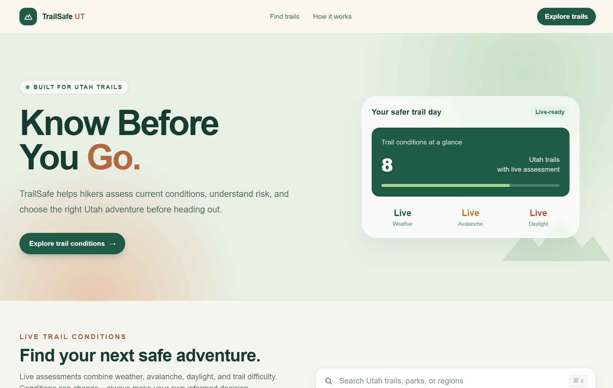
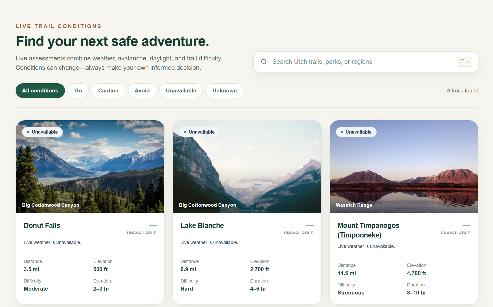
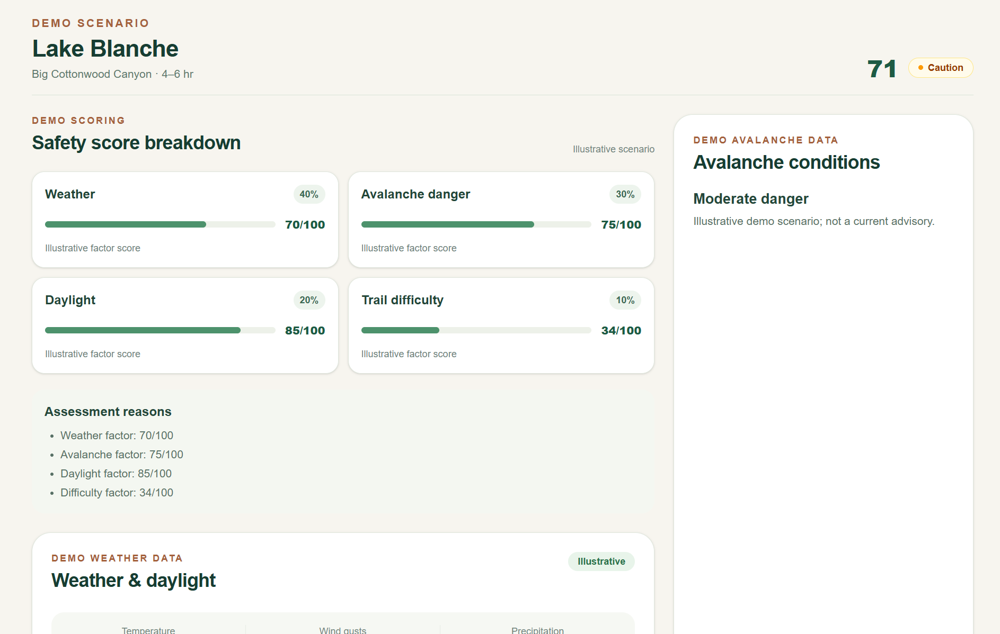
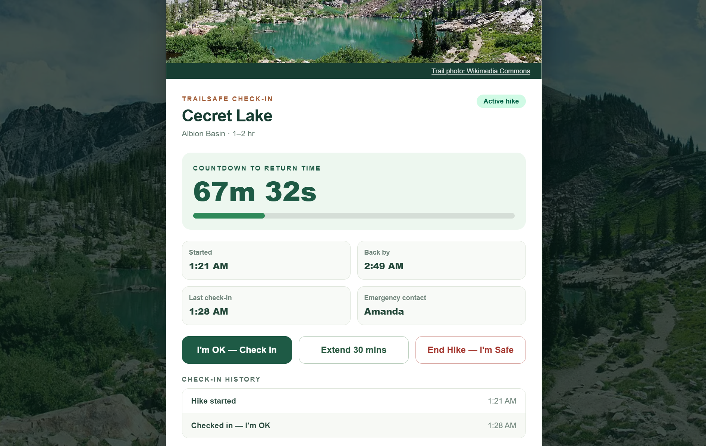
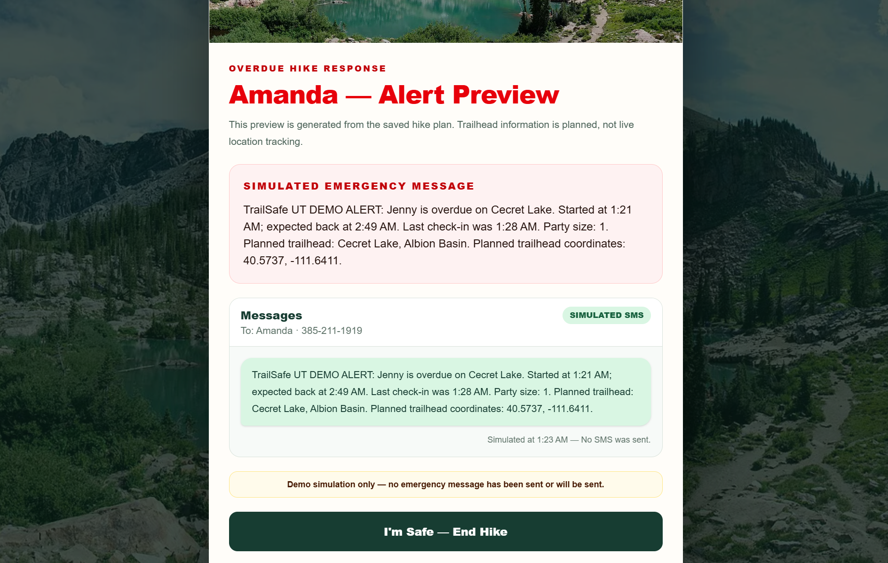

# TrailSafe UT

> **Know Before You Go.**

TrailSafe UT is a Utah hiking-safety web application built as a team hackathon project. It helps hikers explore curated trails, review explainable safety information, and create a personal return-time check-in plan before heading outdoors.

[Live website](https://trail-safe.vercel.app) · [Screenshot demo](https://trail-safe.vercel.app/demo) · [Source repository](https://github.com/AngelAnipah/TrailSafe)

> **Safety notice:** TrailSafe UT provides planning support, not a guarantee of safety. Always consult official forecasts and trail advisories, make your own informed decisions, and call emergency services in a real emergency.

## Screenshots

<table>
  <tr>
    <td width="50%"><strong>Homepage</strong><br /></td>
    <td width="50%"><strong>Trail discovery</strong><br /></td>
  </tr>
  <tr>
    <td><strong>Safety assessment</strong><br /></td>
    <td><strong>Active hike</strong><br /></td>
  </tr>
  <tr>
    <td colspan="2"><strong>Simulated SMS alert</strong><br /></td>
  </tr>
</table>

The alert preview is simulated only: TrailSafe UT does not send SMS messages or contact emergency services.

## Features

- Eight curated Utah hiking trails with search and safety-category filters.
- Explainable safety assessments with factor breakdowns and safety warnings.
- Live Open-Meteo weather, planned-start forecast alignment, sunrise/sunset, and estimated finish-time calculations.
- Avalanche advisory availability checks that fail safely when a valid advisory is not available.
- Trail-detail pages, packing checklist, and trailhead maps.
- Hike check-in flow with an expected-return countdown, check-in history, return-time extension, and overdue grace period.
- Emergency-contact details and a clearly labeled simulated SMS alert experience.
- A dedicated [`/demo`](https://trail-safe.vercel.app/demo) route with deterministic Go, Caution, Avoid, and Unavailable assessment examples for screenshots.

## Safety scoring

TrailSafe UT combines four factors in its standard model:

| Factor | Weight |
| --- | ---: |
| Weather | 40% |
| Avalanche conditions | 30% |
| Daylight | 20% |
| Trail difficulty | 10% |

For routes explicitly marked as not avalanche-applicable, the remaining factors are normalized: weather 57.14%, daylight 28.57%, and difficulty 14.29%. Missing applicable safety information is never interpreted as low risk.

| Category | Current behavior |
| --- | --- |
| **Go** | Score of 85 or higher, with no critical warning. |
| **Caution** | Score from 60 through 84, with no critical warning. |
| **Avoid** | Score below 60, or any verified critical warning. |
| **Unavailable** | Required safety information is missing, stale, invalid, or unavailable. |
| **Unknown** | Defined as a category for compatibility, but not currently emitted by the scoring function. |

A high score is not a guarantee that a hike is safe. Conditions can change rapidly.

## Live assessments, demo data, and alert simulation

| Area | What it uses | Important distinction |
| --- | --- | --- |
| `/` and trail-detail pages | Live provider-backed assessments | Live weather is fetched from Open-Meteo. Avalanche-applicable routes remain Unavailable without a valid advisory. |
| `/demo` | Deterministic illustrative assessments | Every page is prominently labeled **“DEMO DATA — NOT LIVE CONDITIONS.”** Demo data is never used as a fallback for live-provider failures. |
| Hike check-in flow | Browser-local simulation | The app does **not** send SMS messages, email, emergency dispatches, or live GPS updates. Alert previews are simulated only. |

## Known limitations

- The Utah Avalanche Center (UAC) JSON API currently requires authorized access. Without an approved token, it responds with HTTP 401, so avalanche-dependent routes safely remain **Unavailable**.
- The Narrows requires current flash-flood and river-condition checks before an assessment can be issued.
- Active-hike state is stored locally in the browser with `localStorage`; it is not synced across devices.
- There is no real SMS, email, emergency dispatch, live location tracking, or backend safety-monitoring service.
- TrailSafe UT is not a substitute for official forecasts, trail advisories, navigation tools, or emergency services.

## Technology stack

- [Next.js](https://nextjs.org/) 16.4.5
- [React](https://react.dev/) 19.3.0
- [TypeScript](https://www.typescriptlang.org/) 5
- [Tailwind CSS](https://tailwindcss.com/) 4
- [Open-Meteo](https://open-meteo.com/) weather forecasts
- [Utah Avalanche Center](https://utahavalanchecenter.org/) advisory integration
- [OpenStreetMap](https://www.openstreetmap.org/) trailhead maps
- [Vercel](https://vercel.com/) deployment

## Getting started

### Prerequisites

Install Node.js and npm. The repository uses npm and includes a `package-lock.json` for reproducible installs.

```bash
git clone https://github.com/AngelAnipah/TrailSafe.git
cd TrailSafe
git checkout frontend
npm install
npm run dev
```

The repository's default branch is `main`; the finished project work is on `frontend`, so the checkout step above is required. Open [http://localhost:3000](http://localhost:3000). The screenshot-only demo route is available at [http://localhost:3000/demo](http://localhost:3000/demo).

### Quality checks

```bash
npm run lint
npx tsc --noEmit
npm run build
node --experimental-strip-types --test tests/safety.test.ts tests/hike-history.test.ts
```

The repository does not currently define an `npm test` script, so the final command runs the existing test files directly.

## Project structure

```text
src/
├── app/          # App Router pages, including live trails and /demo
├── components/   # Trail discovery, assessment, weather, and hike-flow UI
├── data/         # Curated trails and image metadata
├── lib/          # Weather, avalanche, scoring, demo, and hike-history logic
└── types/        # Shared TypeScript types
tests/            # Safety-scoring and hike-history tests
docs/             # Data-scoring integration documentation
```

## Team contributions

TrailSafe UT was a collaborative hackathon project by:

| Team member | Contribution area |
| --- | --- |
| Angel Anipah | Frontend development, UI integration, and deployment |
| Sumeet Kinger | Hike check-in and simulated SMS experience |
| Mervyn Vera | Weather integration and safety scoring |

The application was delivered as a collaborative team effort across the experience, data integrations, and safety-focused interaction design.

## Credits and attribution

- Weather data: [Open-Meteo](https://open-meteo.com/)
- Avalanche advisories: [Utah Avalanche Center](https://utahavalanchecenter.org/)
- Maps: [OpenStreetMap](https://www.openstreetmap.org/)
- Trail imagery: [Unsplash](https://unsplash.com/) and [Wikimedia Commons](https://commons.wikimedia.org/)
- Trailhead-coordinate references are recorded with the curated trail data.

Wikimedia Commons images retain their individual source links in the application. Review the applicable source and license terms before redistributing imagery.
